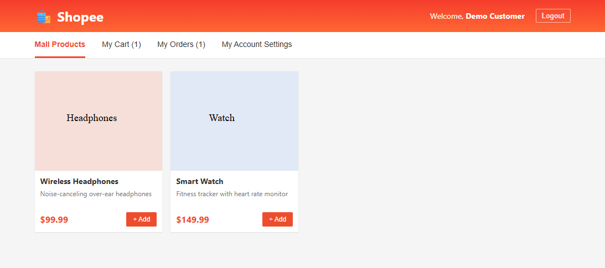
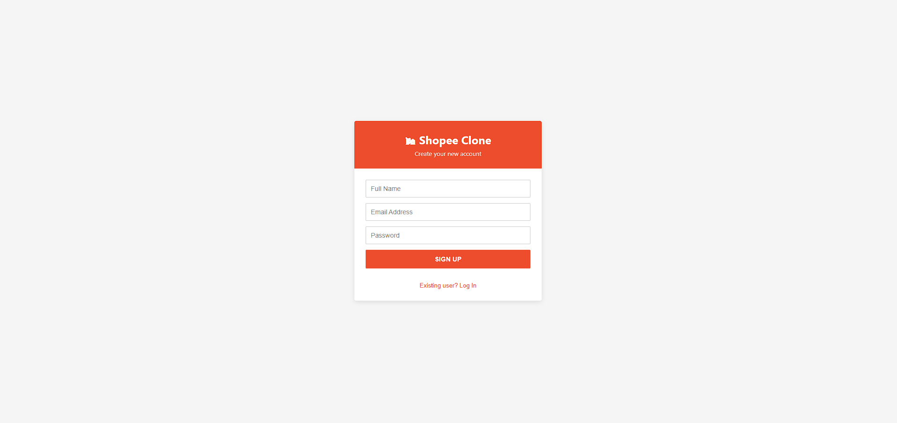
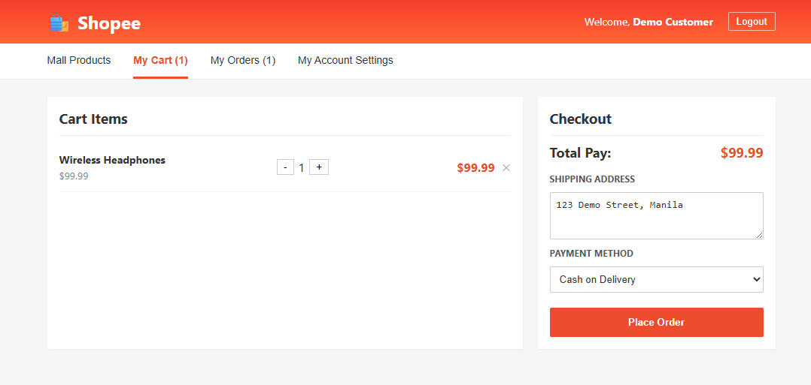
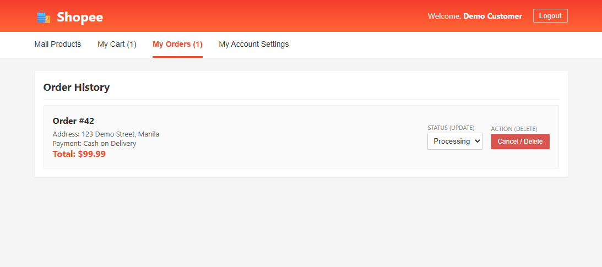
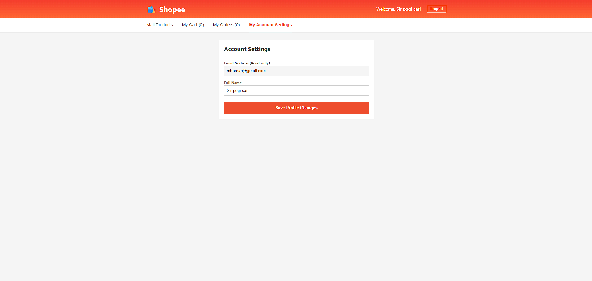

<div align="center">

# Shopee Clone Check-Out Form

**A full-stack e-commerce checkout app with JWT authentication, a MySQL-backed product catalog, and order management.**

*Full-Stack Form Application Project*


[Overview](#overview) · [Requirements Checklist](#-requirements-checklist) · [Quick Start](#-quick-start) · [API](#api) · [Validation](#how-validation-works) · [Troubleshooting](#troubleshooting)



</div>

---

## Overview

Customers can register or log in, browse a MySQL-backed product catalog, manage a cart that is saved per account in the browser, place an order, and review or update their order history.

| | |
| --- | --- |
| **Client** | React 19 · TypeScript · Vite · Axios |
| **Server** | Node.js · Express 5 · CORS |
| **Database** | MySQL with a `mysql2/promise` connection pool |
| **Auth** | JWT + bcryptjs |
| **Forms** | React Hook Form + Zod |
| **Bonus** | Order status updates · JWT-protected routes · Search & price filtering |

```text
client/     React + TypeScript application
server/     Express API, MySQL schema, and environment example
```

## ✅ Requirements checklist

- [x] Registration and login with validation
- [x] MySQL-backed product catalog
- [x] Per-account cart saved in the browser
- [x] Transactional checkout (stock is decremented inside a transaction)
- [x] Order history: view, update status, and delete
- [x] Account management (update display name)
- [x] Server-side price calculation (client-supplied prices and totals are never trusted)
- [x] Parameterized SQL queries throughout

### Bonus features

| Feature | Where | Rubric points |
| --- | --- | --- |
| Order status updates | `PUT /api/orders/:id` | +3 |
| JWT authentication and protected API routes | `/api/auth/*`, `/api/orders/*` | +4 |
| Product search and price filtering | `GET /api/products?search=&minPrice=&maxPrice=` | +2 |
| React Hook Form + Zod validation | Login, signup, checkout, profile forms | n/a |

## Screenshots

These UI captures use sample data from a temporary demo API; they do not create or alter MySQL records.

<table>
  <tr>
    <td align="center">
      <br>
      <b>Sign-in</b><br>
      <sub>Login with validated credentials</sub>
    </td>
    <td align="center">
      <br>
      <b>Product catalog</b><br>
      <sub>Search and price filtering</sub>
    </td>
  </tr>
  <tr>
    <td align="center">
      <br>
      <b>Checkout</b><br>
      <sub>Address and phone validation</sub>
    </td>
    <td align="center">
      <br>
      <b>Order history</b><br>
      <sub>View, update, and delete orders</sub>
    </td>
  </tr>
  <tr>
    <td align="center" colspan="2">
      <br>
      <b>Account management</b><br>
      <sub>Update the signed-in user's name</sub>
    </td>
  </tr>
</table>

## 🚀 Quick start

**Requirements**

- Node.js 20.19 or newer and npm (required by the current Vite release)
- MySQL 8 or a compatible server, with an account that can create/use the `ecommerce_db` database
- Git, if you are cloning the repository

<details open>
<summary><b>1. Get the project and install dependencies</b></summary>

<br>

```sh
git clone https://github.com/JayIOIO/Integrative-Programming-Ecommerce.git
cd Integrative-Programming-Ecommerce
```

Install the root, server, and client dependencies from the project root:

```sh
npm install
npm install --prefix server
npm install --prefix client
```

</details>

<details>
<summary><b>2. Create the database</b></summary>

<br>

Start MySQL, then open [`server/schema.sql`](./server/schema.sql) in MySQL Workbench (or XAMPP phpMyAdmin) and execute the whole file. It creates `ecommerce_db`, the application tables, and sample products.

</details>

<details>
<summary><b>3. Configure environment files</b></summary>

<br>

Copy the example files:

```sh
cp server/.env.example server/.env
cp client/.env.example client/.env
```

On Windows PowerShell:

```powershell
Copy-Item server/.env.example server/.env
Copy-Item client/.env.example client/.env
```

Edit `server/.env` and set `DB_HOST`, `DB_USER`, `DB_PASSWORD`, and `DB_NAME` to match your MySQL installation. Keep `PORT=5000` and `CORS_ORIGIN=http://localhost:5173` for the default local setup.

Replace `JWT_SECRET` with a long, random secret. For example, generate one with:

```sh
node -e "console.log(require('node:crypto').randomBytes(32).toString('hex'))"
```

> ⚠️ Paste the generated value into `server/.env` only. Do not put it in the client environment file, source code, screenshots, or Git.

The client `.env` can usually keep `VITE_API_URL=http://localhost:5000/api`; change it only if your API uses a different URL. Environment files are ignored by Git; only the example templates should be shared.

</details>

<details>
<summary><b>4. Start the application</b></summary>

<br>

From the project root:

```sh
npm run dev
```

This starts the Express API and the Vite client in the same terminal. Keep the terminal open. Open the client URL printed by Vite (normally `http://localhost:5173`); the API is normally at `http://localhost:5000`.

You can also start each service in its own terminal:

```sh
npm run dev --prefix server
npm run dev --prefix client
```

To confirm the API is reachable, open `http://localhost:5000/api/products`. It should return a JSON list.

</details>

<details>
<summary><b>5. Build and check the client</b></summary>

<br>

```sh
npm run build --prefix client
npm run lint --prefix client
```

</details>

## API

All order routes require `Authorization: Bearer <token>`. Order records are restricted to the signed-in user.

| Method | Endpoint | Purpose | Success / error statuses |
| --- | --- | --- | --- |
| POST | `/api/auth/signup` | Create account and issue JWT | 201, 400 |
| POST | `/api/auth/login` | Authenticate and issue JWT | 200, 400 |
| PUT | `/api/auth/profile` | Update the signed-in user's name | 200, 400, 404 |
| GET | `/api/products` | List products; optional `search`, `minPrice`, `maxPrice` | 200, 400, 500 |
| POST | `/api/products` | Create a product (authenticated) | 201, 400, 500 |
| POST | `/api/orders` | Create an order and decrement stock transactionally | 201, 400, 500 |
| GET | `/api/orders` | List the signed-in user's orders | 200, 500 |
| GET | `/api/orders/:id` | Get one of the signed-in user's orders | 200, 400, 404 |
| PUT | `/api/orders/:id` | Update an order status | 200, 400, 404 |
| DELETE | `/api/orders/:id` | Delete an order | 200, 400, 404 |

**Security and data integrity**

- All database operations use parameter placeholders.
- Checkout totals and item prices are calculated from current database product prices; client-supplied prices and totals are not trusted.
- Invalid form input returns `400` with an explanatory error and, when applicable, field errors.

**Search and filtering**

The catalog supports searching product names and descriptions and filtering by price:

```text
/api/products?search=headphones&minPrice=20&maxPrice=100
```

Search text is limited to 100 characters. Prices must be non-negative numbers, with the minimum no greater than the maximum.

## How validation works

Login, signup, checkout, and profile forms use **React Hook Form** with **Zod** schemas in the client; the API re-validates input and returns `400` with field errors.

| Field | Rule |
| --- | --- |
| **Shipping address** (Philippines) | Numbered street/lot address, city or municipality, province or region, and a four-digit ZIP code |
| **Phone** (country-independent) | Optional leading `+`, standard separators, and 7–15 digits |

Phone numbers are stored independently in `checkout_orders.phone`, not appended to the address.

> **Upgrading an existing database?** Run [the order phone migration](./server/migrations/20261019_add_order_phone.sql) before using the updated checkout API.
>
> These format checks cannot confirm that an address or phone number exists or is serviceable.

## Troubleshooting

| Symptom | Things to check |
| --- | --- |
| Browser shows **"Network Error"** | Both services are running; the client's `VITE_API_URL` points to the server; `CORS_ORIGIN` matches the browser URL |
| Catalog, signup, or checkout fails | MySQL is running and `server/schema.sql` has been loaded |
| Server errors on login or signup | A non-empty `JWT_SECRET` is set in `server/.env` |
| Vite fails to start | Node.js is 20.19 or newer |

## Known issues

- MySQL must be running, and the schema must be loaded before using the catalog, registration, or checkout features.
- A non-empty `JWT_SECRET` must be configured in `server/.env`.
- Product creation is exposed as an authenticated API route but is not currently available in the customer interface.

## Team

<!-- Replace with your names, roles, and GitHub profiles -->

| Name | Role | GitHub |
| --- | --- | --- |
| Mhersan John Salenga | Full-stack developer | [@JayIOIO](https://github.com/JayIOIO) |

## License

<!-- Add a LICENSE file to the repo and name it here, e.g. "Released under the MIT License." -->

*License to be added.*
